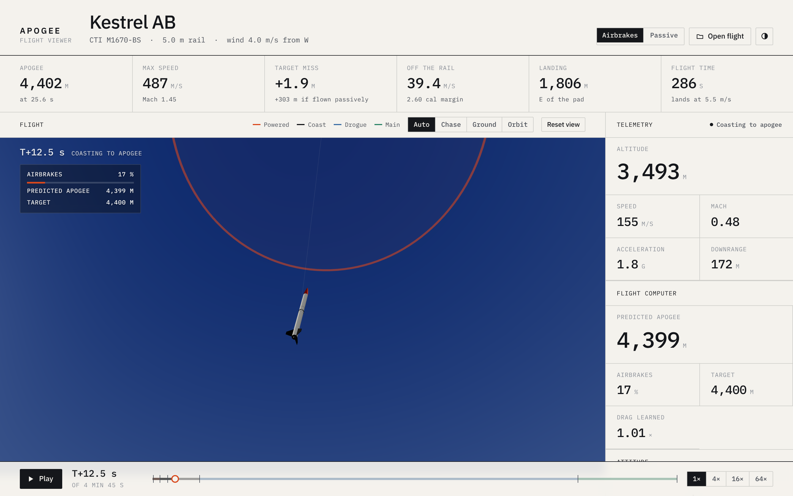
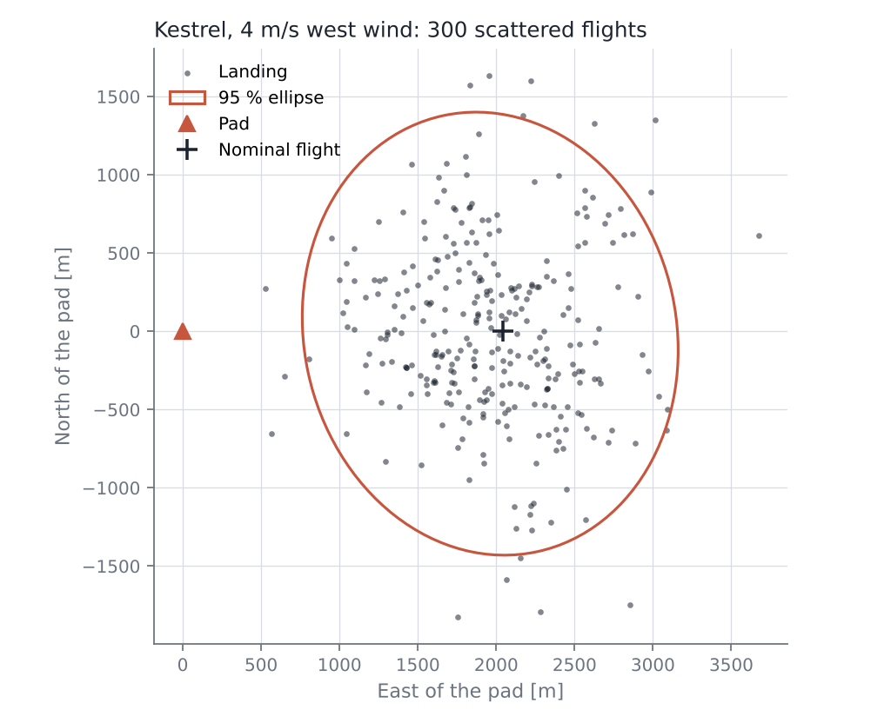
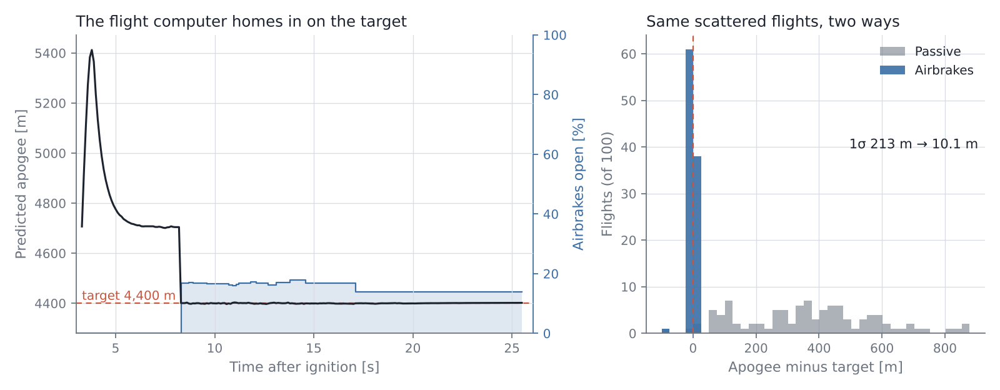

# Apogee

**A rocket flight simulator you can read.** Give it a rocket (nose cone, body tube, fins, motor) and it predicts the whole flight: how high it goes, how fast, how stable it is, and where it lands. Results are checked against analytic solutions and against RocketPy, an independent peer-reviewed simulator: the two agree on apogee to 0.03 %.

Give the rocket **airbrakes** and Apogee flies a simulated flight computer too: noisy barometer and IMU, a Kalman filter, in-flight drag learning and a predictive controller that opens the panels just enough to stop on a target apogee. Over 100 scattered flights it lands every flight that can reach the target within 2.4 m of it, against a ±213 m spread flown passively.

**[Watch Kestrel fly itself to 4,400 m in 3D →](https://haneet10.github.io/Apogee/)**

<picture>
  <source media="(prefers-color-scheme: dark)" srcset="docs/img/viewer-dark.png">
  
</picture>

## Quick start

```bash
pip install git+https://github.com/Haneet10/Apogee
apogee simulate --wind 4
```

With no file it flies the built-in example, Kestrel: a 4-inch fiberglass rocket on a 75 mm M motor, launched into a 4 m/s west wind.

```
Event                     Time  Altitude  Speed
                           [s]       [m]  [m/s]
──────────────────────  ──────  ────────  ─────
Rail exit                 0.32       5.0   40.5
Burnout                   3.90     1,201  486.9
Apogee                   27.43     4,841    3.2
Drogue parachute opens   27.43     4,841    3.2
Main parachute opens    261.40       300   18.7
Landing                 317.28       0.0    6.1

Apogee            4,841 m above the pad, 27.4 s after ignition
Max speed         513 m/s (Mach 1.53) at 3.3 s
Max acceleration  19.6 g at 0.15 s
Off the rail      40.5 m/s
Descent           17.5 m/s under the drogue parachute, then 5.3 m/s under the main parachute
Landing           2,045 m E of the pad (bearing 90°) at 5.3 m/s
Flight time       317.3 s

Wrote 8,543 time steps to kestrel-flight.csv
```

Every time step goes to the CSV for plotting. Add `--json flight.json` and open the file in the [flight viewer](https://haneet10.github.io/Apogee/) to watch it play back. Set the launch with `--rail`, `--tilt`, `--heading`, `--wind`, `--wind-from` and `--elevation`; plain-language warnings flag a slow rail exit, a hard landing or a missing parachute. Full guide: [`docs/flight.md`](docs/flight.md).

### Watch it fly

```bash
apogee simulate my_rocket.yaml --json flight.json
```

Open [haneet10.github.io/Apogee](https://haneet10.github.io/Apogee/), choose **Open flight** (or drop the file on the page) and the flight plays back in 3D: the rocket modelled from its own design file (nose profile, body sections, fins, airbrake panels), its exhaust plume and smoke trail drifting in the wind, the drogue and main canopies opening, all over terrain under a day or dusk sky. A directed camera cuts from a ground tracking camera at liftoff to a chase camera for the coast; **Chase**, **Ground** and **Orbit** pin one. Altitude, speed, acceleration and airbrake extension plot against time, with live telemetry, the flight computer's predicted apogee, the rocket's outline tilting with its attitude (CG and CP marked), and every event one click away. Play at 1× to 64×, scrub the timeline or the plots, and use the keyboard (`Space`, `←` `→`, `,` `.`, `C`). The file is read in your browser and never uploaded. The page opens on Kestrel AB, flown by the current code on every push. Details and the file format: [`docs/viewer.md`](docs/viewer.md).



### Fly to an exact apogee

```bash
apogee simulate examples/kestrel-airbrakes.yaml --wind 4
```

Kestrel AB is Kestrel with a four-panel airbrake bay and a 4,400 m target. After the usual event table it reports how the flight computer did:

```
Target apogee      4,400 m
Reached            4,401.9 m (+1.9 m, +0.04 %)
Without airbrakes  4,703 m (+303 m)
Airbrakes          opened at 8.2 s, Mach 0.79; 15 % open on average, 18 % at most
Drag learned       1.062 × the pre-flight drag model
```

The flight computer never sees the true state. It reads a 1.5 m barometer and a 0.3 m/s² accelerometer at 50 Hz, fuses them in a Kalman filter, learns the rocket's real drag from its deceleration, predicts its own apogee ten times a second and sets the panels (rate-limited, only below Mach 0.8) so the prediction lands on the target. `apogee airbrakes` flies the same scattered flights with and without it:

```
                      Mean apogee  Mean miss  1σ miss  Worst miss  Within ±15 m
                              [m]        [m]      [m]         [m]
────────────────────  ───────────  ─────────  ───────  ──────────  ────────────
Passive                     4,765     +365.3    212.7       878.2           1 %
Airbrakes                   4,399       -0.6     10.1        99.5          99 %
Airbrakes, reachable        4,401       +0.5      0.8         2.4         100 %

The airbrakes cut the 1σ apogee scatter from 213 m to 10.1 m.
2 of 100 flights could not reach the target even with the airbrakes stowed (they only add drag); the last row leaves them out.
```



Method, the full model and what it leaves out: [`docs/airbrakes.md`](docs/airbrakes.md).

### The rocket

```bash
apogee rocket
```

`apogee rocket` lists every part of Kestrel, then the numbers that matter for flight:

```
                Mass       CG  Ixx roll  Iyy pitch
                [kg]     [mm]   [kg·m²]    [kg·m²]
─────────────  ─────  ───────  ────────  ─────────
Dry, no motor  5.731  1,392.0   0.01348      3.154
Liftoff        10.96  1,756.8   0.01865      5.004
Burnout        7.861  1,599.2   0.01647      4.164

Motor   CTI M1670-BS  ·  class M  ·  6,026 N·s  ·  3.90 s burn
Thrust-to-weight at liftoff 14.4 average, 20.5 peak
The CG moves 158 mm forward as the propellant burns.
```

### Where will it land?

```bash
apogee dispersion --wind 4
```

`apogee dispersion` flies the rocket 100 times with the wind, rail angle, airframe mass, motor impulse, drag and parachutes each scattered by a realistic amount, then sizes the recovery area:

```
                         Nominal   Mean   1σ    5 %   95 %
────────────────  ─────  ───────  ─────  ───  ─────  ─────
Apogee            [m]      4,841  4,907  222  4,584  5,274
Landing distance  [m]      2,045  2,004  493  1,181  2,721

Landing zone  95 % ellipse centred 1,920 m E of the pad
              2,961 m long (axis bearing 161°) by 2,244 m wide; it holds 94 % of these flights
Recovery      95 % of flights land within 2,721 m of the pad
```

Every flight goes to a CSV. Each uncertainty has its own flag (`--wind-scatter 2`, `--impulse-scatter 5`, ...); the defaults and method are in [`docs/dispersion.md`](docs/dispersion.md).

### Your own rocket

Describe it in a YAML file, nose to tail. Lengths and masses take units (`mm`, `in`, `g`, `oz`...), and any part you have weighed can carry its real `mass`:

```yaml
name: My first rocket
motor:
  file: Estes_C6.eng            # any RASP .eng file, e.g. from thrustcurve.org
components:
  - nose_cone: {shape: ogive, length: 100mm, diameter: 24.8mm, thickness: 1.5mm, material: polystyrene}
  - body_tube:
      length: 300mm
      thickness: 0.5mm
      material: cardboard
      contents:
        - inner_tube: {length: 70mm, diameter: 19mm, thickness: 0.5mm, material: cardboard}
        - fins: {count: 3, root_chord: 60mm, tip_chord: 30mm, span: 45mm, sweep: 30mm, thickness: 2.4mm, material: balsa}
        - parachute: {diameter: 300mm, mass: 10g, position: 40mm}
```

```bash
apogee simulate my_rocket.yaml   # the whole flight
apogee rocket my_rocket.yaml     # parts, mass, CG and inertia
apogee motor Estes_C6.eng        # impulse, class check, thrust curve
```

Every setting is listed in [`docs/rocket.md`](docs/rocket.md). Typos get a pointed answer: `unknown setting 'lenght'; did you mean 'length'?`

### Will it fly straight?

```bash
apogee aero my_rocket.yaml
```

`apogee aero` finds the centre of pressure, the static margin off the rail and at burnout, and the drag coefficient from Mach 0.1 to 2, split by source. For Kestrel:

```
            CG     CP  Margin
          [mm]   [mm]   [cal]
───────  ─────  ─────  ──────
Liftoff  1,757  1,990    2.28
Burnout  1,599  1,990    3.83
Off the rail: stable. The margin grows as the CG moves forward through the burn.
At 5° angle of attack the body's own lift moves the CP to 1,865 mm (liftoff margin 1.06 cal).

Mach         Re  Friction   Fins   Base   Nose  Cd coast  Cd burn     CP
      [million]                                                     [mm]
────  ─────────  ────────  ─────  ─────  ─────  ────────  ───────  ─────
0.30       17.6     0.339  0.020  0.132  0.000     0.491    0.420  1,992
0.60       35.2     0.330  0.032  0.167  0.000     0.529    0.439  2,000
1.20       70.4     0.272  0.069  0.208  0.040     0.589    0.476  2,043
```

A margin under 1 calibre gets a plain warning and a fix (more fin area or nose weight). Add `finish: smooth_paint` (or `polished`, `unfinished`, ...) to the rocket file to see what a better finish is worth. Method and validation: [`docs/aerodynamics.md`](docs/aerodynamics.md).

### From Python

```python
from apogee import LaunchSite, Wind, load_rocket, simulate

flight = simulate(load_rocket("examples/rocket.yaml"),
                  LaunchSite(rail_length=5.2, wind=Wind(speed=4.0, direction=270)))

flight.apogee                              # 4,841 m above the pad
flight.event("Main parachute opens").time  # 261.4 s
flight.landing_distance                    # 2,046 m downwind
flight.trajectory.position                 # every step, east-north-up [m]

from apogee.playback import write_playback
write_playback(flight, "flight.json")      # for the browser viewer
```

Thrust, gravity, drag, the air's sideways push at the centre of pressure, aerodynamic and jet damping, the launch rail and a wind that strengthens with height all act on the rocket at every step. The lower-level 6-DOF solver (`Dynamics`, `integrate`) is documented in [`docs/dynamics.md`](docs/dynamics.md).

### The atmosphere

```bash
apogee atmosphere 0 1.5km 10000ft
```

```
Altitude    Temp    Temp  Pressure   Density  Sound speed  Viscosity
     [m]     [K]    [°C]      [Pa]   [kg/m³]        [m/s]    [µPa·s]
────────  ──────  ──────  ────────  ────────  ───────────  ─────────
       0  288.15   15.00   101,325    1.2250       340.29    17.8938
   1,500  278.40    5.25    84,560    1.0581       334.49    17.4196
   3,048  268.35   -4.80    69,695   0.90477       328.39    16.9221
```

Altitudes take `m` (the default), `km` or `ft`. Leave them out for a table from sea level to 20 km, or add `--csv` to pipe the numbers into a spreadsheet. From Python:

```python
from apogee import atmosphere

air = atmosphere(1500.0)   # metres above sea level; NumPy arrays work too
air.density                # 1.0581 kg/m³
```

## What it does

- Load a rocket from a readable YAML file and a motor from any standard `.eng` thrust curve
- Work out mass, centre of gravity and moments of inertia, and how they change as the motor burns
- Find the centre of pressure and stability margin, and the drag coefficient across the speed range
- Fly the rocket in six degrees of freedom (position *and* orientation) off a tilted rail, with wind and weathercocking
- Open drogue and main parachutes at apogee or a set altitude, drift with the wind and land
- Report apogee, max speed and acceleration, rail-exit speed, descent rates and the landing point, and write every step to CSV
- Scatter the wind, rail, build and motor over hundreds of flights and map the 95 % landing zone
- Agree with an independent simulator (RocketPy) to 0.1 % on the ascent, with the remaining differences explained
- Fly active airbrakes to a target apogee with a simulated flight computer (noisy sensors, Kalman filter, drag learning, predictive control), and measure how well it does over hundreds of scattered flights
- Play any flight back in the browser in cinematic 3D: the rocket built from its design, plume, smoke, canopies, terrain, directed cameras, plots and events on one clock

## For engineers

- Full flight: events (rail exit, burnout, apogee, deployment, landing) located by bisection on the cubic Hermite interpolant between RK4 steps, then a 3-DOF point-mass descent under the open canopies with a step limited by the drag relaxation rate. Event positions exact to 10⁻⁶ m, apogee converged to 0.2 mm, sink rates within 0.08 % of terminal velocity. Method and validation: [`docs/flight.md`](docs/flight.md)
- Rigid-body 6-DOF equations with quaternion attitude, variable mass, aerodynamic and jet damping, launch-rail constraint and power-law wind, integrated with fixed-step RK4. Checked against vacuum ballistics (10⁻⁹ m), the rocket equation through Kestrel's real burn (5 × 10⁻⁸), torque-free precession with momentum and energy conservation, and the linear pitch-oscillation frequency (0.01 %). Method and validation: [`docs/dynamics.md`](docs/dynamics.md)
- 1976 US Standard Atmosphere, -5 to 86 km, matching every published table value tested to within 0.007 % (the table's own rounding) and checked for hydrostatic balance. Method and validation: [`docs/atmosphere.md`](docs/atmosphere.md)
- Mass model: closed-form hollow cylinders, nose cones integrated as shells of revolution (six profiles, Crowell 1996), trapezoidal fin sets integrated strip by strip, combined with the parallel-axis theorem. Motor propellant burns in proportion to delivered impulse. Every part is checked against a closed-form result, and the example motor's curve integrates to its published 6,026 N·s within 0.006 %. Method and validation: [`docs/rocket.md`](docs/rocket.md)
- Aerodynamics: Barrowman normal-force slopes and CP (nose CP from volume, fins with body interference and Diederich compressibility, Bonney/Ackeret above Mach 1.5), Galejs body lift at angle of attack, Niskanen/Hoerner drag build-up (roughness-limited skin friction, fin edges, base drag reduced by the motor plume) against Mach and Reynolds number, supersonic slender-body wave drag for smooth noses, and pitch damping. Fin and whole-rocket CP match Barrowman's equations worked by hand to 10⁻⁶ nose CPs match six closed forms, and nose wave drag matches von Kármán's `(d/L)²` to 10⁻⁴. Method and validation: [`docs/aerodynamics.md`](docs/aerodynamics.md)
- Validation against RocketPy 1.13 (independent 6-DOF code, LSODA integrator) on the same inputs: apogee, time to apogee, max speed, burnout altitude and deployment time within 0.1 %, static margin identical to three decimals, in calm air and in a crosswind. The one real gap, 146 m more crosswind drift over 2.7 km, is traced to the weathercocking transient off the rail (Apogee includes body lift at angle of attack; its restoring moment matches the hand calculation). Re-checked on every commit. Details: [`docs/validation.md`](docs/validation.md)
- Active airbrakes: a flight computer closed around the 6-DOF solver. Gaussian barometer and accelerometer noise, a three-state Kalman filter (white-jerk model, Joseph-form update), burnout detected from the estimate, in-flight drag-ratio learning, a point-mass RK4 apogee predictor checked against the 6-DOF coast to 0.5 %, and a regula falsi solve for the panel setting with a deadband and a low-speed hold. Panel drag `½ρV²·cd·A·δ` with a slew-rate-limited servo, Mach lockout and burnout lockout, all verified by tests. Method and limitations: [`docs/airbrakes.md`](docs/airbrakes.md)
- Flight viewer: ES modules with three.js (vendored, no build step) for the 3D view and 2D canvases for the plots, falling back to a hand-written orthographic line drawing where WebGL is missing, fed by a versioned JSON playback format. Samples are thinned by phase (0.02 s under thrust, 0.1 s coasting, 0.5 s under canopy) with the event steps always kept, so 8,500 RK4 steps become about 1,000 and linear playback stays within 0.5 m of the solution on the way up (tested). Respects `prefers-reduced-motion` and the system colour scheme. Details: [`docs/viewer.md`](docs/viewer.md)
- Monte Carlo dispersion: seeded, parallel, reproducible for any worker count; landing ellipse from the covariance's eigenvectors and the χ² quantile, tested on known rotated Gaussians (axes within 1 %, coverage within 0.6 %). Method: [`docs/dispersion.md`](docs/dispersion.md)

## Development

```bash
git clone https://github.com/Haneet10/Apogee && cd Apogee
pip install -e ".[dev]"
pytest            # unit tests and doctests
ruff check . && mypy
```

Python 3.11+, NumPy and PyYAML for the solver, pytest for tests, plain HTML/JS (plus a vendored three.js) for the viewer.
