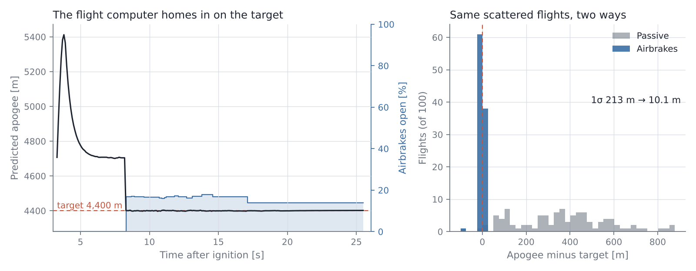

# Airbrakes: flying to an exact apogee

Competition rockets are scored on how close they come to a target altitude. Spaceport
America Cup and Launch Canada both reward it, and no passive rocket can do it reliably:
a few percent of scatter in motor impulse, airframe mass and drag moves Kestrel's apogee
by about ±210 m (1σ). Apogee simulates the fix that university teams fly: deployable
drag panels driven by a flight computer that predicts its own apogee in flight and opens
the panels just enough to stop on the target.

```bash
apogee simulate examples/kestrel-airbrakes.yaml --wind 4
```

```
Event                     Time  Altitude  Speed
                           [s]       [m]  [m/s]
──────────────────────  ──────  ────────  ─────
Rail exit                 0.33       5.0   39.4
Burnout                   3.90     1,137  463.3
Airbrakes open            8.20     2,625  261.4
Apogee                   25.57     4,402    2.1
...

Target apogee      4,400 m
Reached            4,401.9 m (+1.9 m, +0.04 %)
Without airbrakes  4,703 m (+303 m)
Airbrakes          opened at 8.2 s, Mach 0.79; 15 % open on average, 18 % at most
Drag learned       1.062 × the pre-flight drag model
```

`--target 4200` changes the goal, `--no-airbrakes` flies the same rocket passively, and
`--json` writes a playback file in which the [viewer](https://haneet10.github.io/Apogee/)
shows the panels sliding out, the predicted apogee and the target halo.



## How well it works

`apogee airbrakes` flies the same scattered flights twice, passively and with the flight
computer (each flight with its own sensor noise), and compares how far each misses:

```bash
apogee airbrakes --runs 100 --wind 4
```

```
                      Mean apogee  Mean miss  1σ miss  Worst miss  Within ±15 m
                              [m]        [m]      [m]         [m]
────────────────────  ───────────  ─────────  ───────  ──────────  ────────────
Passive                     4,765     +365.3    212.7       878.2           1 %
Airbrakes                   4,399       -0.6     10.1        99.5          99 %
Airbrakes, reachable        4,401       +0.5      0.8         2.4         100 %

The airbrakes cut the 1σ apogee scatter from 213 m to 10.1 m.
2 of 100 flights could not reach the target even with the airbrakes stowed (they only add drag); the last row leaves them out.
```

The scatter is Apogee's default Monte Carlo set (see [`dispersion.md`](dispersion.md))
plus ±10 % on the panels' own drag coefficient, which the flight computer is *not* told.
Two of the hundred flights came out so short (a low-impulse reload, extra drag) that
even stowed panels could not reach 4,400 m; the panels only add drag, so nothing could
help them, and the last row leaves them out. Every flight that *could* reach the target
landed within 2.4 m of it, including the hottest one (5,278 m passively), because the
panels are sized with enough authority (fully open from Mach 0.8 they take nearly 1,000 m off Kestrel's
apogee) for the 3σ spread.

## Adding airbrakes to a rocket

An `airbrakes` part goes in a body tube's `contents`, like fins; the `flight_computer`
section sets the target and the sensors:

```yaml
flight_computer:
  target_apogee: 4400m        # height above the pad
  rate: 50Hz                  # sensors and Kalman filter
  control_rate: 10Hz          # re-planning
  barometer_noise: 1.5m       # 1σ
  accelerometer_noise: 0.3    # m/s², 1σ (or e.g. 0.03g)
  lockout: 1.0s               # after burnout, before the panels may open

components:
  ...
  - body_tube:
      name: Airbrake bay
      length: 120mm
      thickness: 1.6mm
      material: fiberglass
      contents:
        - airbrakes:
            panels: 4
            panel_width: 60mm
            panel_height: 45mm      # how far each panel reaches into the flow
            cd: 1.2                 # flat plate behind a body
            travel_time: 0.4s       # stowed to fully out
            max_mach: 0.8           # never opened faster than this
            length: 100mm
            mass: 480g
```

The module's mass and position count in the rocket's mass, CG and inertia like any other
part. Full example: [`examples/kestrel-airbrakes.yaml`](../examples/kestrel-airbrakes.yaml).

## The model

### The panels

Fully out, the panels add a drag area `cd · A_max` (`A_max = panels × width × height`).
Part-way out the exposed area grows in proportion to the extension `δ`, so the extra drag
is `½ ρ V² · cd · A_max · δ` against the air-relative velocity. The panels are
axisymmetric, so their drag acts along the axis and adds no turning moment. The servo
slews towards the commanded setting no faster than `travel_time` allows; the panels are
stowed at apogee, before the drogue opens.

### The flight computer

The flight software (`apogee.control.FlightComputer`) runs alongside the 6-DOF solver
and only ever sees the rocket through its sensors (plus attitude, from gyros):

1. **Sense, 50 Hz.** Barometric altitude with white noise (1.5 m, typical of an MS5611
   after conversion) and vertical acceleration from the IMU (0.3 m/s²).
2. **Estimate, 50 Hz.** A three-state linear Kalman filter (altitude, vertical velocity,
   vertical acceleration) with a white-jerk motion model fuses the two. Velocity is never
   measured; the filter infers it, about 50 times more accurately than differentiating
   the barometer (tested). Burnout is detected from the estimate, not from a clock.
3. **Learn the drag, 10 Hz.** Coasting, only gravity and drag act, so the measured
   deceleration gives the real drag area. Its ratio to the pre-flight model is low-pass
   filtered into a correction `k`. A rocket that came out draggier or heavier than
   designed is noticed within a second or two.
4. **Predict, 10 Hz.** A point-mass coast in the vertical plane, from the current
   estimate to the top, with the pre-flight `Cd(M)` table times `k` plus the panels held
   at a trial setting. RK4 with a 0.2 s step; the predictor matches the full 6-DOF coast
   to within 0.5 % from three seconds after burnout (tested).
5. **Decide, 10 Hz.** Predicted apogee falls monotonically as the panels open, so the
   setting that tops out on the target is a one-dimensional root, found by regula falsi
   (Illinois variant) to half a metre. If even stowed panels fall short they stay stowed;
   if fully open still overshoots they open all the way. The setting is only re-planned
   when the current one is predicted to miss by more than 2 m, and is frozen below
   30 m/s, where the panels have almost no authority left. Both rules keep the panels
   calm instead of chasing sensor noise.

The panels open only after the burnout lockout and below `max_mach`, and retract when
the filter sees the rocket start to fall.

This is model-predictive control with a one-step horizon: the scheme most university
airbrake teams fly. It re-plans from fresh data ten times a second, so the remaining
model error shrinks as the prediction gets shorter.

## What it leaves out

The simulated flight is kinder than a real one in a few ways, so real airbrake flights
land within roughly ±10 to 30 m rather than the few metres here:

- **Barometer errors.** Static-port position error near Mach 1, the lag of a sealed
  avionics bay and a non-standard day (a 10 °C warmer atmosphere stretches barometric
  altitude by about 3.5 %) are not modelled. Truth and flight computer share the 1976
  Standard Atmosphere.
- **Mechanics.** Backlash, panel flutter and the servo's own dynamics beyond a slew
  limit are not modelled.
- **Wind.** The predictor ignores the wind's effect on airspeed; the drag correction
  absorbs most of it.
- **Attitude.** The flight path angle comes from the true attitude, as if the gyros were
  perfect over the 25 s ascent.

Each is a natural next step, and the sensor and filter classes in `apogee.avionics` are
small enough to extend.

## Tests

`tests/test_avionics.py` and `tests/test_control.py` check, among other things: sensor
noise statistics and seeding; the Kalman filter tracking a ballistic coast (altitude RMS
under 0.8 m, velocity under 0.5 m/s with a 1.5 m barometer) and staying positive
definite; the predictor against the 6-DOF coast; the regula falsi setting hitting its
goal to 0.5 m and clipping at both ends; the closed loop reaching 4,400 m within 5 m,
correcting a draggier, heavier rocket with weaker panels within 8 m, keeping the panels
stowed for an unreachable target and saturating for one too low; the lockout, the Mach
limit and the servo rate never being violated; and the rocket-file parsing and its error
messages. `tests/test_airbrake_cli.py` covers the commands and the playback file.
