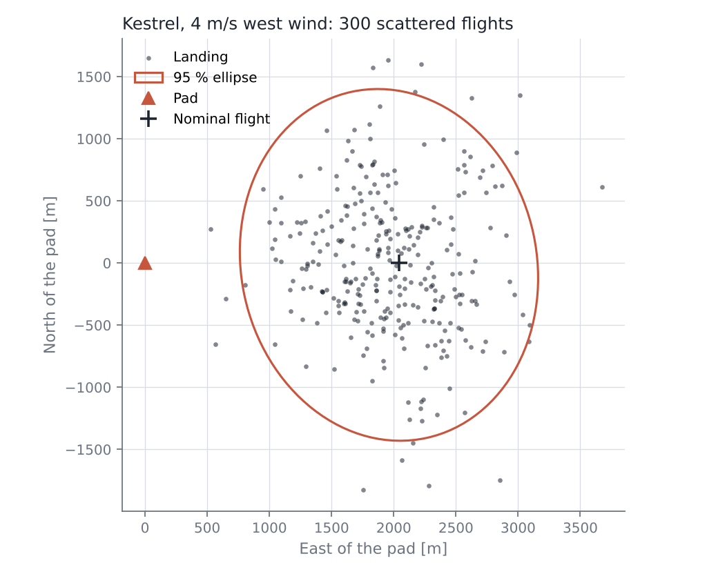

# Landing dispersion (Monte Carlo)

**Where will it come down?** One simulated flight gives one landing point, but no launch goes exactly to plan. `apogee dispersion` flies the rocket a hundred times with the wind, the rail, the build and the motor each a little different, and tells you how big a field you need.



## Quick start

```bash
apogee dispersion --wind 4
```

```
Kestrel  ·  CTI M1670-BS
5 m rail, vertical  ·  wind 4 m/s from W (270°)  ·  pad at sea level
Scatter (1σ): wind ±1 m/s, ±15°  ·  rail ±0.5°, ±5°  ·  mass ±2 %  ·  impulse ±3 %  ·  drag ±5 %  ·  parachute Cd ±5 %

100 flights, seed 1, 48 s

                         Nominal   Mean   1σ    5 %   95 %
────────────────  ─────  ───────  ─────  ───  ─────  ─────
Apogee            [m]      4,841  4,907  222  4,584  5,274
Max speed         [m/s]      513    516   16    490    540
Off the rail      [m/s]     40.5   40.5  0.6   39.5   41.5
Landing distance  [m]      2,045  2,004  493  1,181  2,721
Landing speed     [m/s]      5.3    5.3  0.1    5.0    5.5

Landing zone  95 % ellipse centred 1,920 m E of the pad
              2,961 m long (axis bearing 161°) by 2,244 m wide; it holds 94 % of these flights
Recovery      95 % of flights land within 2,721 m of the pad

Wrote 100 flights to kestrel-dispersion.csv
```

The nominal column is the flight with every input as written. The rest describe the scattered flights: their mean, standard deviation and the range that holds the middle 90 %. Flights run in parallel, one per CPU core; the same `--seed` always gives the same flights.

For Kestrel the take-away is plain: in a 4 m/s wind, plan for recovery anywhere up to 2.7 km downwind, and expect the apogee anywhere from about 250 m below the prediction to 430 m above it. Most of that apogee spread comes from the ±5 % drag uncertainty, which is why a real flight is the best way to pin down a rocket's Cd.

## Options

Launch conditions take the same flags as `apogee simulate` (`--rail`, `--tilt`, `--heading`, `--wind`, `--wind-from`, `--elevation`). The rest:

| Flag | Default | What it scatters (one standard deviation) |
|---|--:|---|
| `--runs N` | 100 | number of scattered flights |
| `--seed N` | 1 | random seed |
| `--wind-scatter` | 1 m/s | wind speed at 10 m |
| `--wind-from-scatter` | 15° | wind direction |
| `--tilt-scatter` | 0.5° | rail angle from vertical, as set up on the pad |
| `--heading-scatter` | 5° | direction the rail leans |
| `--mass-scatter` | 2 % | airframe mass (and inertia), motor excluded |
| `--impulse-scatter` | 3 % | motor total impulse, at the same burn time |
| `--drag-scatter` | 5 % | zero-lift drag coefficient |
| `--chute-scatter` | 5 % | parachute drag coefficients |
| `--workers N` | CPU count, up to 8 | parallel processes |
| `--dt S` | 0.02 | 6-DOF time step |
| `-o CSV` | `<rocket>-dispersion.csv` | one row per flight: every input, then apogee, speeds and landing point; `none` to skip |

Set any scatter to 0 to hold that input fixed, for example `--wind-scatter 0 --wind-from-scatter 0` to see what the build tolerances alone do.

From Python:

```python
from apogee import LaunchSite, Scatter, Wind, load_rocket, monte_carlo

d = monte_carlo(load_rocket("examples/rocket.yaml"),
                LaunchSite(wind=Wind(speed=4.0, direction=270)),
                runs=200, scatter=Scatter(wind_speed=2.0))
d.apogee            # NumPy array, one apogee per flight [m]
d.ellipse(0.95)     # centre, semi-axes and bearing of the landing ellipse
d.radius(0.95)      # recovery radius around the pad [m]
d.write_csv("dispersion.csv")
```

## For engineers

**Sampling.** Each input is drawn from an independent normal distribution around its nominal value. All draws are made up front from one seeded NumPy generator, so results do not depend on the number of worker processes. Multipliers are clipped to 0.5-1.5 and the wind speed to zero or more. A tilt draw below zero leans the rail the other way (heading + 180°).

**Perturbing the rocket.** `Rocket.perturbed()` returns a copy with the airframe's mass and both moments of inertia scaled (CG unchanged), the thrust curve scaled (so total impulse changes at the same burn time and propellant mass), the zero-lift drag coefficient scaled, and every canopy's Cd scaled.

**Default scatter.** The values follow the stochastic 6-DOF study of Box, Bishop and Hunt, "Stochastic six-degree-of-freedom flight simulator for passively controlled high-power rockets", *Journal of Aerospace Engineering* 24(1), 2011: wind speed and direction are the dominant landing-point uncertainty; impulse spread reflects motor certification testing (NFPA 1127), and 5 % on Cd reflects the typical gap between a drag build-up and a flown rocket.

**Landing ellipse.** For landing points with sample covariance Σ, the ellipse xᵀΣ⁻¹x = k² with k² = −2 ln(1 − p), the chi-squared quantile with two degrees of freedom, holds a fraction p of a bivariate normal population. Its semi-axes are k√λ along the eigenvectors of Σ. The report also states the share of the simulated flights the ellipse actually holds, a direct check of the normal assumption, and the empirical 95th-percentile distance from the pad, which needs no assumption at all.

**Time step.** Scattered flights use a 0.02 s step for the 6-DOF ascent and 0.25 s under the parachutes. Against the 0.01 s default this moves Kestrel's apogee by 0.3 m and its landing point by under 1 m, far below the scatter.

**Validation.**

| Check | Result |
|---|---|
| Ellipse of 50,000 points from a known rotated Gaussian (σ 300 m × 100 m, axis 30°) | semi-axes within 1 %, bearing within 0.5°, holds 95.0 % |
| Coverage at p = 0.5, 0.9, 0.99 | within 0.6 % of p |
| Drawn inputs, 20,000 samples | means and standard deviations within 2 % of the requested values |
| Zero scatter | every flight repeats the nominal flight exactly |
| Same seed, 1 or 2 worker processes | identical flights |
| More drag, less apogee; less drag, more | holds |

Tests: [`tests/test_montecarlo.py`](../tests/test_montecarlo.py).
