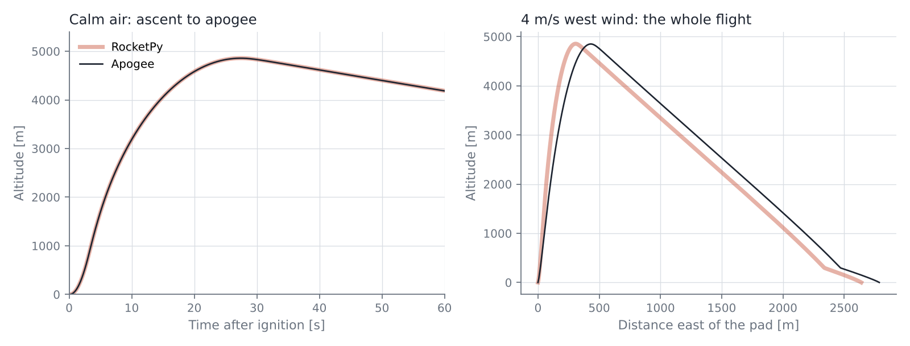

# Validation against RocketPy

**Apogee and an independent simulator fly the same rocket and land within a tenth of a percent of each other on the way up.** This page shows the comparison, what it does and does not prove, and the one place the two disagree.



## The reference

[RocketPy](https://github.com/RocketPy-Team/RocketPy) 1.13.0 is an open-source 6-DOF simulator for high-power rockets, published in the *Journal of Spacecraft and Rockets* (Ceotto et al., 58(4), 2021) and checked by its authors against real flights. It shares no code with Apogee: it has its own equations of motion, an adaptive LSODA integrator (Apogee uses fixed-step RK4), its own Barrowman lift and centre of pressure, its own motor mass model, launch rail and parachute descent.

The plan was OpenRocket. OpenRocket 23.09 could not be run in the environment these numbers were produced in, so RocketPy took its place; an OpenRocket cross-check is on the [roadmap](roadmap.md#backlog).

### Same inputs, independent flight mechanics

Both simulators are given:

| Input | Source |
|---|---|
| Geometry: nose, body, fins, motor position | `examples/rocket.yaml` |
| Dry mass, CG, moments of inertia | Apogee's mass model ([rocket.md](rocket.md)) |
| Zero-lift drag coefficient against Mach, motor on and off | Apogee's drag build-up ([aerodynamics.md](aerodynamics.md)); RocketPy has no drag model of its own and always takes a Cd curve |
| Thrust curve and propellant mass | `examples/motors/Cesaroni_M1670.eng` |
| Atmosphere, gravity | 1976 US Standard Atmosphere, gravity falling with height |
| Launch rail, wind profile, parachutes | the same numbers in both |

Everything downstream is computed separately: thrust and burning mass over time, normal force and centre of pressure, rail exit, weathercocking, the trajectory, event timing and descent. So the comparison tests Apogee's flight mechanics. It does not test the drag or mass models, which are checked against closed-form and published results on their own pages.

The script that produced the reference is [`validation/rocketpy_reference.py`](../validation/rocketpy_reference.py); its output is committed in [`validation/rocketpy/`](../validation/rocketpy/), and [`tests/test_validation.py`](../tests/test_validation.py) re-flies both cases on every commit and fails if Apogee drifts from these numbers.

## Results

### Calm air, vertical 5 m rail

| Quantity | Apogee | RocketPy | Difference |
|---|--:|--:|--:|
| Apogee | 4,857.3 m | 4,858.6 m | -0.03 % |
| Time to apogee | 27.42 s | 27.43 s | -0.03 % |
| Max speed | 513.7 m/s | 513.7 m/s | -0.01 % |
| Max Mach | 1.525 | 1.526 | -0.07 % |
| Max acceleration | 19.61 g | 19.54 g | +0.33 % |
| Rail exit speed | 40.48 m/s | 40.48 m/s | +0.01 % |
| Altitude at burnout | 1,202.9 m | 1,203.0 m | -0.01 % |
| Main parachute opens | 262.0 s | 262.1 s | -0.02 % |
| Landing | 317.9 s | 315.1 s | +0.87 % |
| Landing distance | 0 m | 10 m | -10 m |
| Static margin, liftoff | 2.285 cal | 2.285 cal | +0.00 % |
| Static margin, burnout | 3.830 cal | 3.830 cal | +0.00 % |

### 4 m/s west wind, rail tilted 5° east

| Quantity | Apogee | RocketPy | Difference |
|---|--:|--:|--:|
| Apogee | 4,850.6 m | 4,855.7 m | -0.10 % |
| Time to apogee | 27.42 s | 27.43 s | -0.04 % |
| Max speed | 513.7 m/s | 513.7 m/s | +0.00 % |
| Max Mach | 1.524 | 1.525 | -0.09 % |
| Max acceleration | 19.61 g | 19.55 g | +0.32 % |
| Rail exit speed | 40.49 m/s | 40.48 m/s | +0.02 % |
| Altitude at burnout | 1,201.2 m | 1,201.9 m | -0.06 % |
| Main parachute opens | 261.7 s | 261.9 s | -0.08 % |
| Landing | 317.6 s | 315.0 s | +0.81 % |
| Landing distance | 2,787 m | 2,641 m | +146 m |
| Static margin, liftoff | 2.285 cal | 2.285 cal | +0.00 % |
| Static margin, burnout | 3.830 cal | 3.830 cal | +0.00 % |

## Reading the differences

**The ascent agrees to 0.1 %.** Apogee, time to apogee, peak speed and burnout altitude all match to within 0.1 % in both cases, through a supersonic burn and a 24-second coast, with different integrators. The static margins match to three decimals: RocketPy's Barrowman centre of pressure and Apogee's are the same 1,990 mm. The 0.3 % in peak acceleration is the sampling of a sharp thrust spike in the first 0.15 s.

**Descent takes 0.9 % longer in Apogee because it keeps the drogue.** Under the drogue the two descend at the same speed (17.5 m/s). When the main opens, RocketPy replaces the drogue with it, while Apogee, like OpenRocket, keeps both canopies open, as they are on a real dual-deploy rocket where the drogue stays tied to the airframe. The extra drag area (Cd·A 4.50 m² against 4.07 m²) gives 5.29 m/s against 5.57 m/s under the main, the ratio √(4.50/4.07) = 1.05 expected for terminal velocity.

**The calm landing point differs by 10 m because RocketPy includes the Earth's rotation.** Its Coriolis term pushes a rising rocket west; Apogee assumes a flat, non-rotating Earth, a negligible effect at hobby scale.

**Wind drift on the way up is where they differ: Apogee drifts 146 m further downwind.** From apogee to the ground the two drift 2,356 m and 2,334 m, within 1 %. The gap opens in the first second after the rail, while the rocket turns into the relative wind:

| Diagnostic, 4 m/s wind, vertical rail | Apogee | RocketPy |
|---|--:|--:|
| Restoring moment just off the rail | 1.32 N·m | 3.25 N·m |
| Same, without body lift | 2.19 N·m | 3.25 N·m |
| Linear Barrowman by hand, `q A CNα (x_cp − x_cg) sin α` | 2.07 N·m | |
| Body axis from vertical at 2 s | 3.6° | 4.6° |
| Drift at apogee | 254 m W | 386 m W |

Most of the gap is a modelling choice. Leaving the rail at 40 m/s into a 3.6 m/s crosswind, Kestrel meets the air at 5° angle of attack, where Apogee adds the body's cross-flow lift (Galejs), as OpenRocket does. That lift acts ahead of the CG and cuts the restoring moment by 40 %, so Apogee's rocket turns into the wind more slowly. With body lift switched off, Apogee's drift at apogee grows from 254 m to 298 m. The rest comes from RocketPy's restoring moment itself, which is about 1.5 times the linear Barrowman value worked by hand from the same CNα and centre of pressure, even though both codes report identical CNα (11.67 per radian at Mach 0.1) and CP. Apogee's moment matches the hand calculation, and its pitch dynamics match the linear oscillation frequency to 0.01 % ([dynamics.md](dynamics.md)).

What it means in practice: for Kestrel in a 4 m/s wind the two simulators' landing points are 146 m apart after a 2.7 km drift, well inside the landing zone that the Monte Carlo scatter of wind and build tolerances predicts ([dispersion.md](dispersion.md)). An OpenRocket cross-check of this case is the obvious next step.

## Reproduce

```bash
pip install rocketpy==1.13.0 matplotlib
python validation/rocketpy_reference.py   # regenerate the reference (a few seconds)
python validation/report.py               # these tables and the figure
pytest tests/test_validation.py           # the checks that run on every commit
```
